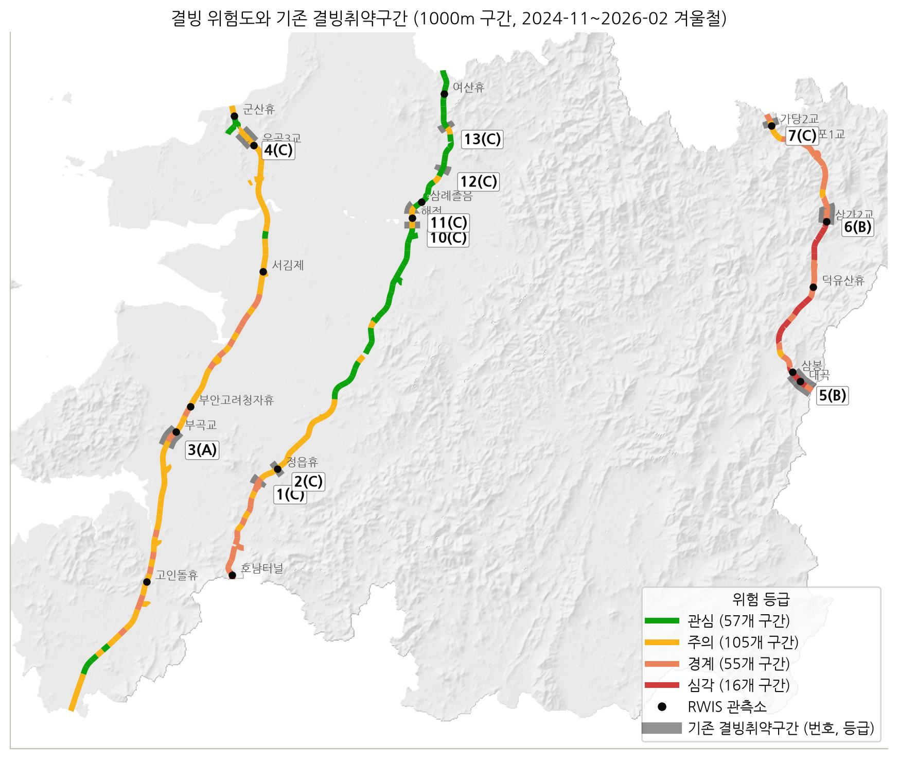

# 기상과 도로환경 융합자료를 활용한 AI 기반 전북도 고속도로 결빙 위험도 분석

2026 DATA·AI 분석 경진대회(전주기상지청 출제) 제출 결과물입니다.

## 1. 개요

전북 고속도로 3개 노선(서해안선, 통영-대전중부선, 호남선)을 약 1km 구간 233개로 나누고 구간별 기상학적 결빙 위험도를 계산했습니다. 관측소가 없는 구간의 노면온도와 결빙 가능성을 AI 모델로 추정하고, 기상·도로·지형 요인을 합쳐 4등급으로 나타냈습니다.

| 제출 형식 | 파일 |
|--------|------|
| 구간별 추정값, 결빙 영향인자, 환경조건(임계값), 상관분석 | `data/results/segment_factors.csv`, `segment_risk.csv`, `icing_factors.csv`, `icing_conditions.csv` |
| 학습에 쓰지 않은 관측소와의 비교 수치 (BIAS, MAE, RMSE, 상관계수) | `data/results/estimation_scores.csv`, 기상요인별 보조표 `weather_scores.csv` |
| 노면상태 F1-score, Precision, Recall | `data/results/icing_scores.csv`, `icing_daily_scores.csv` |
| 검증 지점 10분 단위 예측 | `data/results/holdout_submission_10min.csv` |
| 결빙 위험도 기준표 | `data/results/risk_criteria.csv`, 이 문서 8-4 |
| 위험도 지도 | `figures/risk_map.jpg`, `risk_map.png`, `risk_map.html`, `risk_map_shp/` |
| 기존 결빙취약구간 비교 통합본 | `figures/risk_map_vulnerable.jpg`, `risk_map_shp/vulnerable_sections.shp`, `data/results/vulnerable_comparison.csv` |
| 관측값 추정·결빙 분류 모델 | `model/` |
| 실행 매뉴얼과 코드 | 이 문서, `notebooks/`, `src/`, `scripts/` |
| 데모영상 | `demo/demo.mp4` |

설명 문서(`2026_AIcontest_report.docx`)와 발표자료(`2026_AIcontest_presentation.pptx`)는 제출 압축 파일과 따로 제출합니다.

## 2. 폴더 구성

GitHub 저장소에는 코드와 모델, 그림만 올렸습니다. 제공 자료와 그 자료로 만든 파일, 데모영상은 제출 압축 파일에만 넣었습니다.

| 경로 | 내용 | GitHub | 제출 압축 파일 |
|------|------|:--:|:--:|
| `README.md` | 결과물 구성, 실행환경, 실행 방법 | O | O |
| `requirements.txt`, `environment.yml` | 라이브러리 버전 (pip, conda) | O | O |
| `data/raw/` | 대회 제공 데이터 | X | X |
| `data/external/` | 추가 데이터 (ERA5-Land, 해기차, 상습 결빙구간) | X | O |
| `data/processed/` | 추론과 모델 재학습에 쓰는 중간 자료 | X | O |
| `data/results/` | 성능지표, 기준표, 구간별 위험도 CSV | X | O |
| `model/` | 노면온도 추정 `road_temp_*`, 결빙 분류 `icing_*` | O | O |
| `src/` | 공통 설정, 평가 함수, 외부 자료 접합, 결빙취약구간 위치 계산 | O | O |
| `notebooks/` | 단계별 Notebook (01~05) | O | O |
| `scripts/` | 추론, 전체 실행, 모델 비교, 외부 자료 내려받기, 제출 파일 만들기 | O | O |
| `demo/` | 데모영상 | X | O |
| `figures/` | 결과 그림, 지도, shapefile | O | O |
| `docs/external_data.md` | 추가 데이터 명세 | O | O |
| `jeonbuk_map_code/` | 위험도 지도, API, 실시간 추정 코드 | O | O |

`data/raw/`는 크기가 958MB라서 제출 파일에서 뺐습니다. 대회 페이지의 `DATA AI 경진대회 데이터(20261007).zip`을 풀어 3장의 구조로 두면 됩니다.

### src/

| 파일 | 역할 |
|------|------|
| `config.py` | 경로, 분석 기간, 대상 노선, 검증 지점, 결빙 판정 기준, 구간 길이 |
| `evaluate.py` | BIAS·MAE·RMSE, 주최 측 기준의 일별 F1·Precision·Recall |
| `external.py` | 추가 데이터 격자 연결, 10분 시간축 정렬, 구간·지점 변수 접합 |
| `vulnerable.py` | 기존 결빙취약구간 22개소 표, 이정을 도로 위 위치로 바꾸는 계산 |

데이터 처리와 학습 코드는 `notebooks/`에 있습니다.

### scripts/

| 파일 | 역할 |
|------|------|
| `run_inference.py` | 저장된 모델로 검증 지점을 예측하고 지표를 출력 |
| `run_notebooks.py` | 노트북을 순서대로 실행 |
| `check_icing_models.py` | LightGBM과 로지스틱 회귀의 차이를 시드 5개로 측정 |
| `make_submission.py` | 제출 압축 파일 만들기 |
| `external/` | ERA5-Land, 850hPa, OISST를 받아 추가 데이터 파일을 만드는 스크립트 |

## 3. 데이터

대회 페이지의 전체 데이터를 내려받아 압축을 풀고 내용을 `data/raw/`에 그대로 둡니다.

```
data/raw/
├── 1. 전북도 고속도로 RWIS(도로기상) 관측 데이터/          일별 CSV 240개
├── 1-1. 전북도 고속도로 목표안개 관측소(2개소) 관측 데이터/  일별 CSV 240개
├── 2. 전북도 ASOS(종관기상) 관측 데이터/                  일별 CSV 240개
├── 3. 전북도 AWS(방재기상) 관측 데이터/                   일별 CSV 240개
├── 4. 전북도 교량 위경도 데이터.csv
├── 5. 전북도 터널 위경도 데이터.csv
├── 6. 전북도 고속도로 중심선 데이터/
├── 7. 전북도 수치 표고 모델 고도 데이터.tif
├── 8. 국토교통부 도로, 교량, 터널, 하천 경계 데이터.zip
└── 데이터 설명자료(노면상태, 풍향, 운형, 현상번호).pdf
```

기간은 2024-11-01 ~ 2025-02-28, 2025-11-01 ~ 2026-02-28입니다. 공개된 공공 기상자료는 활용 근거와 출처를 밝히면 쓸 수 있습니다(QnA 2026-10-07). 추가 데이터의 전체 명세는 `docs/external_data.md`에 있습니다.

### 추가 데이터

| 자료 | 출처와 이용 조건 | 받는 방법 | 쓰는 곳 |
|------|------|------|------|
| ERA5-Land 재분석 (0.1° 격자 27개, 1시간) | Copernicus Climate Data Store `reanalysis-era5-land-timeseries`. CC-BY 4.0. Muñoz-Sabater et al. (2021) | `scripts/external/download_era5_cells.py` (CDS 계정 필요) | 02-3 정렬, 03-2, 04-2, 05-1, 05-2의 M3 |
| 서해 해기차 (해수면온도 - 850hPa 기온, 6시간) | NOAA OISST v2.1 (doi:10.25921/RE9P-PT57, 인용 표기), ERA5 기압면 (Hersbach et al. 2020, CC-BY 4.0) | `scripts/external/download_era5_850hpa.py`, `build_dT_final.py`. 850hPa 요청 스크립트는 실제 내려받기를 확인하지 못했습니다 | 02-3의 6-4, 04-2, 05-1 |
| 행정안전부 상습 결빙구간 | 공공데이터포털 15067396, 이용허락범위 제한 없음 | 공공데이터포털에서 CSV 내려받기 | 22개소 위치의 기준점 (`src/vulnerable.py`) |
| 나들목 누적거리와 좌표 | 위키백과 노선 문서(CC BY-SA), OpenStreetMap Nominatim(ODbL) | `src/vulnerable.py`에 기준점으로 기재 | 22개소 위치의 기준점 |

ERA5-Land는 눈과 비를 나눠 주고 RWIS 관측이 동화되지 않아서 골랐습니다. 해기차는 서해에서 눈구름이 발달하는 조건을 나타냅니다. 오대호 기준은 13°C(Niziol 1987), 기상청 자료의 서해 임계값은 15°C입니다.

교차검증으로 잰 기여는 다음과 같습니다.

| 쓰임 | ERA5-Land | 서해 해기차 |
|------|------|------|
| 노면온도 추정 | B3 1.590°C, ERA5 복사 1.594°C, ERA5 기온 1.821°C. 쓰지 않음 | 해당 없음 |
| 결빙 분류 (LightGBM 시드 3개 평균) | AP(Ice) 0.0107에서 0.0119, 일별 F1 0.0318로 같음. 쓰지 않음 | AP(결빙관련) 0.4677에서 0.4855, Ice AP는 거의 같음. 쓰지 않음 |
| 영향인자 (AUC) | 3시간 강설 0.87, 단일 변수 중 가장 높음 | 서해안선 0.81, 호남선 0.73, 통영-대전중부선 0.58 |
| 위험도 | M3로 233개 구간 중 38개 등급이 바뀜 | 구간을 가르지 못해 시간 지표로만 사용 |

일별 F1 차이의 95% 구간은 모든 경우에 0을 포함했습니다. 해기차 15°C 이상, 서~북서풍, 850hPa -8°C 이하를 함께 쓰면 겨울 시간의 25%가 되고 서해안선 Ice의 78%, 호남선의 77%, 통영-대전중부선의 53%를 포함합니다.

## 4. 실행환경

| 항목 | 버전 |
|------|------|
| OS | Ubuntu 24.04.4 LTS (Windows WSL2) |
| Python | 3.12.14 |
| 패키지 관리 | conda 26.1.1 |
| CPU·메모리 | 16코어, 15GB |
| GPU | 사용하지 않음 |

| 분류 | 라이브러리 |
|------|-----------|
| 데이터 처리 | numpy 2.5.3, pandas 3.0.6, pyarrow 25.0.1, scipy 1.18.1 |
| 공간 데이터 | geopandas 1.2.0, shapely 2.1.2, pyproj 3.8.0, pyogrio 0.13.0, rasterio 1.5.1 |
| 모델 | scikit-learn 1.9.1, lightgbm 4.7.0, xgboost 3.4.1 |
| 시각화 | matplotlib 3.11.2, folium 0.20.0 |

모든 코드와 주석은 UTF-8입니다. 추론, 학습, 평가는 외부 AI 서비스나 API 없이 실행됩니다. 추가 데이터를 다시 받을 때만 CDS 계정이 필요합니다. 그림의 한글은 NanumGothic, 맑은 고딕, AppleGothic 중 설치된 글꼴로 표시합니다.

지도 서비스의 네이버 배경지도·경로 위험과 기상청 API허브 현재 관측 연결은 선택 기능입니다. 키가 없어도 저장된 결과로 지도, API, 재생 시연이 동작해서 심사용 인증정보는 따로 제공하지 않습니다. 이 외부 API는 관측 수집과 지도 표시에만 쓰고 분석과 예측은 제출 모델이 합니다.

## 5. 환경 구성

conda로 전체 환경을 재현합니다.

```bash
conda env create -f environment.yml
conda activate haksik
```

pip를 쓸 수도 있습니다.

```bash
python3.12 -m venv .venv
source .venv/bin/activate
pip install -r requirements.txt
```

## 6. 실행 방법

### 저장된 모델로 추론

제출 압축 파일에는 추론에 필요한 자료가 들어 있어서 바로 실행됩니다.

```bash
python scripts/run_inference.py
```

검증 지점 3곳의 노면온도와 10분 단위 결빙을 예측하고 지표를 출력합니다. 저장된 제출 표와 값이 같은지도 확인합니다. 약 1초 걸립니다.

### 최종 모델 다시 학습

제출 압축 파일에는 최종 모델을 학습하는 자료도 들어 있어서 `data/raw/` 없이 실행됩니다. 16코어에서 약 2분 걸립니다.

```bash
python scripts/run_notebooks.py --only 03-3   # 노면온도 모델 학습, 검증 지점 평가
python scripts/run_notebooks.py --only 04-1   # 결빙 모델 교차검증, 학습
python scripts/run_notebooks.py --only 04-3   # 결빙 검증 지점 평가
```

### 전체 재실행

`data/raw/`와 `data/external/`을 둔 뒤 실행합니다. 16코어에서 약 1시간 40분 걸립니다.

```bash
python scripts/run_notebooks.py               # 01-2부터 05-2까지
python scripts/run_notebooks.py --start 04-1  # 04-1부터
python scripts/run_notebooks.py --only 05-2   # 하나만
```

빈 폴더에서 처음부터 실행해 오류 없이 끝나는 것을 확인했습니다. 일별 지표, 구간 등급 233개, 결빙 모델은 저장된 결과와 같았습니다. 비교용 `LightGBM(전체)`만 멀티스레드 차이로 0.001°C 수준으로 달라집니다.

노트북은 자기 폴더를 작업 폴더로 삼고 앞 노트북이 저장한 `data/interim/`, `data/processed/`를 뒤 노트북이 읽습니다.

| Notebook | 내용 |
|----------|------|
| `01_data_exploration/01-1_theory.md` | 이론적 배경과 검증할 가설 (문서) |
| `01_data_exploration/01-2_data_quality.ipynb` | 데이터 구성, 관측망, 결측·이상값·센서 고착 점검 |
| `01_data_exploration/01-3_road_surface.ipynb` | 노면온도와 노면상태(Ice) 분포 |
| `01_data_exploration/01-4_icing_weather.ipynb` | 결빙 기상 조건, 두 겨울 비교, 기온감률, 사례, 검증 지점 |
| `01_data_exploration/01-5_road_terrain_fog.ipynb` | 도로·지형 자료, 목표안개 관측소 |
| `01_data_exploration/01-6_theory_check_icing.ipynb` | 이론 검증 Ⅰ: 결빙 조건 |
| `01_data_exploration/01-7_theory_check_spatial.ipynb` | 이론 검증 Ⅱ: 노면온도의 공간 변동과 노면상태, 탐색 정리 |
| `02_preprocessing_features/02-1_cleaning.ipynb` | 정제, 10분 시간축 정렬, 결빙 라벨 |
| `02_preprocessing_features/02-2_features_segments.ipynb` | 변수 생성, 구간 분할 |
| `02_preprocessing_features/02-3_external_era5.ipynb` | ERA5-Land와 해기차를 10분 시간축에 정렬 |
| `03_observation_estimation/03-1_estimation_cv.ipynb` | 관측값 추정 후보 모델 교차검증 |
| `03_observation_estimation/03-2_estimation_experiments.ipynb` | 고전 ML, MLP, 앙상블, 지점 특성 실험, RWIS 보간 개선(B3) |
| `03_observation_estimation/03-3_estimation_holdout.ipynb` | 검증 지점 평가, 기상요인별 보조 평가, 모델 저장 |
| `04_icing_classification/04-1_icing_cv.ipynb` | 결빙 분류 후보 모델 교차검증, 최종 모델 선택과 해석 |
| `04_icing_classification/04-2_icing_experiments.ipynb` | 고전 ML, MLP, 앙상블 비교, 추가 자료 기여 |
| `04_icing_classification/04-3_icing_holdout.ipynb` | 검증 지점 평가, 제출 항목 표 |
| `05_risk_map/05-1_icing_factors.ipynb` | 구간별 추정, 결빙 영향인자와 임계값, 구간별 상관분석 |
| `05_risk_map/05-2_risk_map.ipynb` | 위험도 기준표, 구간별 위험도, 기존 취약구간 비교, 지도 |

### 지도와 API

시간별 지도는 `jeonbuk_map_code/output/jeonbuk_risk_atlas.html`입니다. 제공 자료가 들어 있어서 제출 압축 파일에만 넣었습니다.

제출 압축 파일에서는 Python 3.9 이상만 있으면 API와 지도 화면이 실행됩니다. 추가 패키지와 키는 필요하지 않습니다.

```bash
cd jeonbuk_map_code
python service/server.py --open
```

`http://localhost:8000`에서 지도 화면을, `/api-docs`에서 API 설명을 볼 수 있습니다. 네이버 배경지도, 출발지·도착지 경로, 현재 관측 연결은 키가 있을 때만 동작합니다. GitHub 저장소에는 결과 묶음(`bundle/`)이 없어서 노트북을 05-2까지 실행하고 `python jeonbuk_map_code/export_bundle.py`로 먼저 만들어야 합니다. 자세한 내용은 `jeonbuk_map_code/README.md`에 있습니다.

## 7. 평가 방법

주최 측 QnA 답변을 기준으로 했습니다.

- 검증 지점(학습 제외)은 부곡교(12410, 서해안선), 삼봉(33411, 통영-대전중부선), 해전(23402, 호남선)입니다.
- 검증 지점의 실측값과 다른 학습 지점의 같은 시각 노면상태는 입력으로 쓰지 않았습니다(2026-11-02). 주변 RWIS의 노면온도는 답변 범위에 없어서 입력으로 썼습니다.
- 노면온도는 검증 지점 실측값과 비교해 BIAS, MAE, RMSE를 구합니다.
- 결빙은 Ice만 결빙이고 그 외 유효한 상태는 비결빙입니다(2026-10-07). 노면상태 0·-999는 평가에서 뺍니다(2026-09-30).
- 일(00:00~23:50)별 TP, FP, FN으로 F1, Precision, Recall을 구해 평가기간 평균을 냅니다. 시각은 10분 단위로 정확히 맞아야 합니다(2026-11-02).
- 실제·예측 결빙이 모두 없는 날은 평균에서 뺍니다(2026-09-30). 결빙을 놓친 날은 Precision을 빼고 Recall·F1은 0입니다(2026-10-13). 예측만 한 날은 Recall을 빼고 Precision·F1은 0입니다(2026-11-03).
- 지점별 평균과 세 지점 평균을 제시합니다(2026-09-29). 실제 결빙이 한 번도 없는 지점은 '산출불가'로 적고 평균에서 빼며 활용 지점 수와 평가 날짜 수를 적습니다(2026-11-02·11-03).
- 위험도 기준표는 평가표 항목을 모두 담지 않고 제공·공개 자료로 산정할 수 있는 요소로 만들었습니다(2026-11-03).

## 8. 결과

### 8-1. 노면온도 추정

최종 방법은 LightGBM, Ridge, 주변 노면온도 보간(B1), 밑그림과 크리깅(B3)의 단순 평균입니다. 학습 지점 교차검증 RMSE는 1.513°C입니다. 검증 지점은 전체 기간(240일) 10분 단위 기준입니다.

| 지점 | BIAS (°C) | MAE (°C) | RMSE (°C) | 상관계수 |
|------|------:|------:|------:|------:|
| 부곡교 | -0.547 | 0.679 | 0.918 | 0.995 |
| 해전 | -0.764 | 0.807 | 1.005 | 0.996 |
| 삼봉 | -0.011 | 0.556 | 0.753 | 0.993 |
| 세 지점 평균 | -0.440 | 0.680 | 0.892 | 0.995 |

보간 기온을 그대로 쓴 기준(B0)의 세 지점 평균 RMSE는 3.405°C입니다. 검증 지점은 4km 안에 학습 지점이 있어서 관측소에서 먼 구간의 오차는 교차검증 값에 더 가깝습니다.

검증 지점은 노면온도와 노면상태만 관측합니다. 다른 기상요인은 기온, 습도, 풍속을 재는 RWIS 9곳에서 구간 입력으로 쓰는 AWS 보간값을 평가했습니다. 이 9곳의 관측은 보간에 쓰지 않았습니다.

| 요소 (9개 지점 평균) | BIAS | MAE | RMSE | 상관계수 |
|------|------:|------:|------:|------:|
| 기온 (°C) | -0.409 | 0.895 | 1.569 | 0.968 |
| 상대습도 (%) | -0.297 | 5.768 | 7.220 | 0.947 |
| 풍속 (m/s) | 0.580 | 1.040 | 1.354 | 0.568 |

### 8-2. 결빙 분류

최종 모델은 결빙관련 상태(Snow, Ice, 결빙시작, 판별불가)로 학습한 LightGBM입니다.

| 지점 | F1 | Precision | Recall | 평가일수 (F1/P/R) | 결빙일 | 오탐일 |
|------|------:|------:|------:|:--:|------:|------:|
| 부곡교 | 0.028 | 0.025 | 0.187 | 30 / 22 / 19 | 19 | 22 |
| 해전 | 산출불가 | 산출불가 | 산출불가 | 0 | 0 | 16 |
| 삼봉 | 산출불가 | 산출불가 | 산출불가 | 0 | 0 | 20 |
| 지점 평균 (활용 1개소) | 0.028 | 0.025 | 0.187 | 30 / 22 / 19 | 19 | 22 |

부곡교 10분 단위로는 TP 11, FP 368, FN 53입니다. 일별 F1이 낮은 이유는 Ice 라벨에 있습니다. Ice는 전체의 0.05%이고 대부분 10분 한 번 나타납니다. 실제 노면상태를 알고 결빙 관련 상태 전체를 결빙으로 예측해도 일별 F1은 0.102입니다.

교차검증에서 LightGBM과 로지스틱 회귀는 일별 F1(차이 95% 구간 [-0.007, +0.041])과 AP(Ice)로 구분되지 않았습니다. AP(결빙관련)은 LightGBM이 높아서(차이 구간 [+0.003, +0.054]) 최종 모델로 정했습니다. 검증 지점 일별 F1은 로지스틱이 0.034로 조금 높습니다.

### 8-3. 결빙 영향인자와 환경조건

학습 지점 관측자료로 정한 결빙 가능 조건은 노면온도 ≤ 1.0°C, 습도 ≥ 70%, 수분 공급(최근 12시간 강수, 적설, 노면 ≤ 이슬점 중 하나)입니다. 전체 시간의 12.8%이고 Ice의 75.3%를 포함하며 조건 안의 Ice 비율은 평균의 5.9배입니다.

단일 변수 판별력(AUC)은 ERA5 3시간 강설 0.87, 강수 후 경과시간 0.85, 적설 0.85, 최근 12시간 강수시간 0.83 순입니다. 이 지역 Ice의 81%는 강수 중이거나 강수 후 3시간 안에 나왔습니다. 두 겨울의 기온은 비슷했는데 눈이 많았던 2024-25 겨울의 Ice가 3.2배였습니다.

구간별 표는 `data/results/segment_factors.csv`입니다. 구간 233개마다 기상 요약, 모델이 결빙관련 노면으로 예측한 시간의 환경조건(노면온도·기온·노면-이슬점 차 상한, 습도 하한), 저온 시간의 결빙관련 확률과 기상요인의 순위상관, 주요 영향인자 1~3위를 담습니다. 구간별 1위 인자는 최근 12시간 강수시간 87개, 습도 61개, 노면-이슬점 차 45개, 적설 27개, 강수 후 경과시간 13개 구간이고 노면온도, 기온, 풍속이 1위인 구간은 없습니다. 학습 지점의 실제 결빙관련 노면으로 계산해도 상위 세 인자는 최근 12시간 강수시간, 적설, 강수 후 경과시간으로 같습니다.

### 8-4. 결빙 위험도 기준표

총점 = 0.5 x 기상 + 0.25 x 도로 + 0.25 x 지형 (1~4점)입니다. 기상과 지형은 하위 지표의 평균, 도로는 최댓값입니다. 기상 지표의 수준은 구간 233개의 사분위수이고 등급은 총점 범위 1~4를 같은 폭으로 나눴습니다. 기준 설정 근거는 `data/results/risk_criteria.csv`의 마지막 열과 05-2의 3장에 있습니다.

| 요인 | 지표 | 수준 1 | 수준 2 | 수준 3 | 수준 4 |
|------|------|------|------|------|------|
| 기상 | M1 결빙 가능 시간 (h/겨울) | ≤264 | 264~288 | 288~338 | >338 |
| 기상 | M2 결빙관련 노면 예측 시간 (h/겨울) | ≤22 | 22~28 | 28~38 | >38 |
| 기상 | M3 영하 노면 강설 시간 (h/겨울) | ≤50 | 50~70 | 70~91 | >91 |
| 도로 | R1 교량 구간 비율 | 0 | 0~10% | 10~30% | >30% |
| 도로 | R2 터널 입출구 | 터널 안·해당 없음 | 터널 1km 이내 | 입출구 300m 이내 | - |
| 지형 | T1 표고 | <100m | 100~250m | 250~400m | ≥400m |
| 지형 | T2 겨울 지형 그늘 비율 | <2% | 2~5% | 5~10% | ≥10% |
| 지형 | T3 하천 인접·골짜기 | 해당 없음 | 하천 300m 이내 또는 TPI ≤ -10m | 하천 100m 이내 또는 TPI ≤ -30m | - |

| 등급 | 총점 | 의미 | 서해안 | 호남 | 통영-대전 | 전체 |
|------|------|------|------:|------:|------:|------:|
| 관심 | 1.00~1.75 | 평상시 관리 | 11 | 46 | 0 | 57 |
| 주의 | 1.75~2.50 | 결빙 가능 기상 시 순찰 강화 | 72 | 26 | 7 | 105 |
| 경계 | 2.50~3.25 | 사전 제설·제빙 우선 구간 | 17 | 13 | 25 | 55 |
| 심각 | 3.25~4.00 | 상시 감시·사전 살포 최우선 구간 | 0 | 1 | 15 | 16 |

관측소 17곳에서 총점과 노면 0°C 이하 비율의 순위상관은 0.63입니다. Ice 비율과는 0.02로 상관이 없습니다. 총점은 저온 노출을 잘 나타내지만 Ice 빈도를 맞히는 값은 아닙니다.

곡선 반경과 종단경사는 기존 평가표의 기하구조 분야가 이미 점수화해서 총점에 넣지 않았습니다. 이 기준표는 그 표의 기후 특성(6점)을 보완하는 기상 위험 정보입니다. 곡선 반경은 `segment_risk.csv`의 `curve_radius_m` 열로 제공합니다. 460m 미만 17개는 모두 연결로이고, 도로 요인에 넣으면 18개 구간의 등급이 바뀝니다(본선 4개). 종단경사는 DEM이 지표면 높이라서 도로 경사로 잴 수 없었습니다(구간 양끝 기준 최대 16.9%).

### 8-5. 기존 결빙취약구간과 비교



문제 설명의 22개소 중 대상 노선의 전북 구간에 들어오는 11곳을 비교했습니다. 표의 이정은 행정안전부 상습 결빙구간 좌표와 나들목 기준점으로 도로 위 위치로 바꿨습니다.

연결된 구간 25개의 경계·심각 비율은 48.0%이고 전체 구간은 30.5%입니다. 같은 노선에 무작위로 놓아도 평균 41.2%가 나와서(p = 0.29) 노선 구성을 빼면 차이를 확인할 수 없습니다. 기존 B등급 2곳의 구간은 모두 경계 이상이고 A등급 1곳은 구간 3개 중 2개가 경계입니다. C등급 8곳은 평균 19%입니다.

심각 구간 16개 중 12개는 기존 취약구간 밖입니다(통영-대전중부선 11개, 호남선 1개). 기존 평가표는 사고 이력과 도로 운영까지 보고 이 등급은 기상, 도로, 지형만 봅니다. 이 12개 구간은 기상 관점에서 다시 점검할 후보로 제시합니다.

### 8-6. 한계

- 검증 지점의 결빙 평가는 부곡교 한 곳의 19일 결과입니다.
- 검증 지점은 학습에 쓰지 않았지만 구성 판단 일부에는 참고했습니다(03-2의 3-7, 04-1의 1장). 표고 추세는 교차검증이 나아졌는데도 검증 지점이 나빠져서 뺐고, B1 유지와 지문 미반영은 앙상블 교차검증이 거의 같아서 검증 지점을 보고 정했습니다. 앙상블 교차검증이 가장 낮은 구성을 골랐다면 검증 지점 RMSE는 약 0.92°C입니다.
- 추정 오차의 절반 가까이는 지점 고유 편향입니다. 학습 지점 14곳으로는 이를 일반화하지 못했고, 학습 지점의 절반은 휴게소·졸음쉼터 안 센서입니다.
- 주변 RWIS 노면온도를 입력으로 씁니다. 주최 측 답변은 노면상태만 다뤘습니다. 노면온도까지 금지라면 검증 지점 RMSE는 약 1.42~1.46°C로 나빠집니다.
- 표고 보정이 산지의 밤 노면온도를 조금 낮게 추정합니다.
- 구간 233개 중 22개는 본선에서 벗어난 IC·JC 연결로 등입니다. 심각 등급은 없고 `segment_risk.csv`의 `on_mainline` 열로 구분합니다.
- 실시간 지도·API는 제공 자료 재생으로 확인했고 실제 기상청·네이버 API 키로는 확인하지 못했습니다.

## 9. AI 활용범위 및 주요 검토 과정

| 항목 | 내용 |
|------|------|
| 활용 도구 | Claude Code (Claude Opus 5.5), GitHub Copilot |
| 활용 단계 | 프로젝트 구조 설계, 실행환경 문서화, 지도·API 제작 |
| 주요 활용 내용 | Claude Code: 제출 규정에 맞춘 폴더 구조와 `.gitignore`, 분석 코드 뼈대(모듈·함수 구성, Notebook 단계 구성), 실행환경 설정 파일과 README 초안 작성, 코드를 주피터 노트북에 통합, 논문 내용을 md 파일로 요약 저장, 결빙 위험도 지도와 API 제작 지원<br>GitHub Copilot: 코드 및 주석 작성 보조 |
| 참가자 주요 기여 및 검증 | 데이터 탐색·전처리, 변수 설계, 모델 선택·학습·평가, 함수 구현, 결과 분석을 팀원이 직접 수행 |
| 검토한 대안 및 실패사례 | (작성 예정) |
| 최종 선택 이유 | (작성 예정) |
